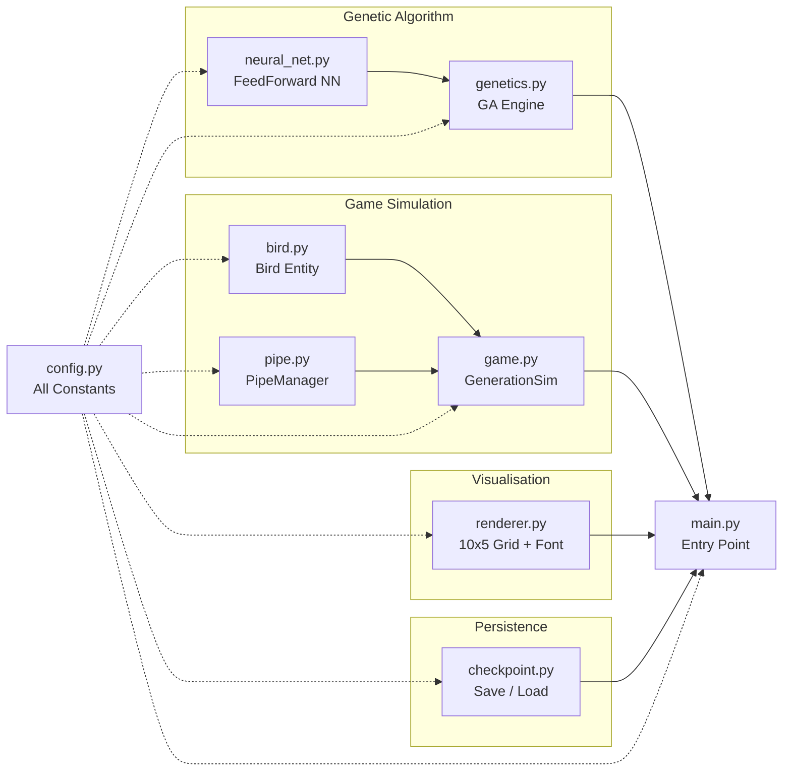

# Flappy Bird NeuroEvolution Training Pipeline

## Dependencies

- **Python 3.10+** (tested on 3.14)
- **pygame** (any version — uses zero `pygame.font`/`pygame.freetype` calls)
```bash
pip install pygame
```
- No other external packages required


## File Map (9 modules)

| File | Purpose |
|------|---------|
| [`config.py`](config.py) | Tunable constants: physics, GA parameters, 10x5 grid geometry, colors |
| [`neural_net.py`](neural_net.py) | Lightweight feedforward neural network (4→8→1, tanh/sigmoid activations) |
| [`genetics.py`](genetics.py) | GA engine: tournament selection, uniform crossover, Gaussian mutation, elitism |
| [`bird.py`](bird.py) | Bird physics + normalized 4D AI observation vector |
| [`pipe.py`](pipe.py) | Pipe generation, continuous scrolling, and collision boundaries |
| [`game.py`](game.py) | GenerationSim: population of 50 birds sharing the same pipe stream |
| [`renderer.py`](renderer.py) | 10×5 live training grid, dead‑cell freezing, ASAP spinner, showcase renderer, built‑in 5×7 bitmap font |
| [`checkpoint.py`](checkpoint.py) | Serialization saving every completed generation to `./checkpoints/` |
| [`main.py`](main.py) | CLI flags, interactive menu, paginated checkpoint selector, showcase playback, and human play |

## Execution Modes & CLI

```bash
# 1. Interactive Main Menu
python main.py

# 2. Fresh Training Mode
python main.py --train

# 3. Load & Showcase Trained Checkpoint (Press Space to replay)
python main.py --load 10

# 4. Load & Showcase with Auto‑Restart on Death
python main.py --load 10 --ar

# 5. Play as a Human (Space/Up to flap)
python main.py --human

# 6. Launch Directly in Fullscreen
python main.py --fullscreen
```

## Real‑Time Controls

| Context | Key / Action | Behavior |
|---------|-------------|----------|
| **Train / Load** | **Hold [F]** | Fast‑forward animation (5 sub‑steps at 180 FPS) |
| **Train Mode** | **Toggle [G]** | Fast‑train 5 generations ASAP (displays animated orbital spinner overlay) |
| **Train Mode** | **Toggle [P]** | Pause / resume training |
| **Train Mode** | **[ESC]** | Instantly abort to menu without saving the in‑progress generation |
| **Load Mode** | **[SPACE / ENTER]** | Replay trial after bird death (unless `--ar` is passed) |
| **All Modes** | **[F11] / [Cmd+F]** | Toggle native macOS fullscreen (or use the green maximize window button) |
| **All Modes** | **[ESC]** | Return to menu / quit |

## Training & Checkpoint Lifecycle

1. **Every Completed Generation Saved**: Checkpoints are stored for every generation (`bird_gen_1.pkl`, `bird_gen_2.pkl`, …) including all in‑between generations during 5‑generation ASAP bursts.
2. **Safe Abort Protection**: If the user aborts mid‑generation via <kbd>ESC</kbd> or window close, the in‑progress generation is **discarded and never saved**, keeping checkpoint files strictly representative of completed generations.
3. **Paginated Checkpoint Browser**: In the "Load Checkpoint" menu, up to 28 checkpoints are rendered per page in a 4‑column grid with `< PREV` and `NEXT >` buttons, supporting keyboard arrow keys and mouse selection across all saved generations.
4. **Isolated Status Indicators**: In Load/Showcase mode, the `FAST (5X)` badge is rendered in a pill container in the top‑right corner with ample clearance from the centered header.

## AI Input Vector (4 Dimensions)

1. `dx` – Horizontal distance from bird to the next pipe's left edge
2. `dy_top` – Vertical distance from bird Y to bottom edge of the top pipe
3. `dy_bottom` – Vertical distance from bird Y to top edge of the bottom pipe
4. `vel_y` – Bird's current vertical velocity

## Architecture Overview


